# ER / Relationship Diagram (as built)

- New Django app: `iic_booking.connect`. Table prefix `connect_`.
- Existing models are shaded as "existing" and are referenced only, never altered. The one exception is the new `discussions` entry in the in-code notification category list, which is not a schema change.

```mermaid
erDiagram
    %% ---------- existing (read only) ----------
    User ||--o{ Booking : "books (Booking.user)"
    EquipmentGroup ||--o{ Equipment : "Equipment.equipment_group"
    Equipment ||--o{ Booking : ""
    Equipment ||--o{ EquipmentManager : "OIC"
    Equipment ||--o{ EquipmentTemporaryOIC : "temp OIC"
    Equipment ||--o{ EquipmentOperator : "Lab Operator / Lab In-charge"
    Equipment ||--o{ EquipmentOperatorCoverage : "leave cover"

    %% ---------- communities ----------
    EquipmentGroup |o--o| Community : "kind=GROUP (SET_NULL; id+name snapshot kept)"
    Community ||--o{ CommunityMembership : ""
    User ||--o{ CommunityMembership : "one per user per community"
    CommunityMembership ||--o{ MembershipAuditLog : "append-only"
    User ||--o{ ConnectRoleAssignment : "Community Admin (global)"
    Community ||--o{ DiscussionCategory : "admin-managed"
    SyncRun ||--o{ MembershipAuditLog : "report"

    %% ---------- threads ----------
    Community ||--o{ DiscussionThread : ""
    DiscussionCategory |o--o{ DiscussionThread : ""
    Equipment |o--o{ DiscussionThread : "equipment_id, permanent"
    User ||--o{ DiscussionThread : "author"
    DiscussionThread ||--|{ DiscussionPost : "post #1 = opening post"
    DiscussionPost |o--o{ DiscussionPost : "reply-to (parent)"
    DiscussionPost ||--o{ DiscussionPostRevision : "edit history"
    DiscussionPost ||--o{ DiscussionAttachment : ""
    DiscussionTag ||--o{ ThreadTag : ""
    DiscussionThread ||--o{ ThreadTag : ""
    DiscussionThread ||--o| AcceptedSolution : "current (Question / Technical Issue)"
    DiscussionPost ||--o| AcceptedSolution : ""
    DiscussionThread ||--o{ DiscussionPollOption : "type=Poll"
    DiscussionPollOption ||--o{ DiscussionPollVote : "one vote per user per poll"
    User ||--o{ DiscussionDraft : "autosave"

    %% ---------- user actions ----------
    DiscussionPost ||--o{ DiscussionReaction : "helpful / thanks / insightful"
    User ||--o{ DiscussionSubscription : "thread or community"
    User ||--o{ DiscussionBookmark : ""
    User ||--o{ ThreadReadState : "views, unread"
    DiscussionPost ||--o{ DiscussionReport : ""

    %% ---------- moderation / notifications ----------
    User ||--o{ ModerationAction : "actor (append-only)"
    User ||--o{ DiscussionNotification : "recipient"
    DiscussionThread ||--o{ DiscussionNotification : ""
    User ||--o| ConnectNotificationPreference : "immediate / daily / weekly / off"

    %% ---------- knowledge ----------
    Community ||--o{ KnowledgeArticle : "inherited from source; never widened"
    DiscussionThread |o--o{ KnowledgeArticle : "source_thread"
    DiscussionPost |o--o{ KnowledgeArticle : "source_post"
    Equipment |o--o{ KnowledgeArticle : ""
    KnowledgeArticle ||--o{ KnowledgeArticleRevision : ""
    KnowledgeArticle ||--o{ KnowledgeArticleReview : "reviewer decisions"

    %% ---------- announcements ----------
    DiscussionThread ||--o| CommunityAnnouncement : "type=Announcement"
    CommunityAnnouncement ||--o{ AnnouncementAcknowledgement : ""

    %% ---------- recognition / analytics ----------
    User ||--o{ UserBadgeAward : ""
    RecognitionBadge ||--o{ UserBadgeAward : ""
    User ||--o{ ConnectSearchLog : "aggregated only"
```

## Key constraints and indexes

### Communities
- **Community**:
  - `kind` ∈ {GROUP, GENERAL}.
  - Partial unique on `equipment_group_id WHERE kind='GROUP'` and on `kind WHERE kind='GENERAL'`, so exactly one General community exists.
  - Also `slug` (unique), `equipment_group_ref_id` (int snapshot), `group_name_snapshot`.
  - `status` ∈ {ACTIVE, ARCHIVED}. A removed group is archived, never deleted.
  - Also `is_test_only`.
- **CommunityMembership**:
  - `UniqueConstraint(community, user)`.
  - Source flags `via_booking`, `via_oic`, `via_operator`, `via_manual`, recomputed idempotently.
  - `role` ∈ {MEMBER, MODERATOR}.
  - `status` ∈ {ACTIVE, LAPSED, SUSPENDED, REVOKED}. LAPSED means a staff source ended and there is no booking (pending Q3).
  - Also `first_booked_at`, `last_booked_at`.
  - Index `(user, status)` for the "my communities" lookup.
- **General community**: access is implicit for every authorised user, so there is no row per user. Rows exist only for moderators and suspensions.

### Threads and posts
- **DiscussionThread**:
  - Fields: `type`, `status` (OPEN/LOCKED), `visibility` (VISIBLE/HIDDEN/REMOVED), `is_pinned`, `solved_at`.
  - Denormalised `reply_count`, `view_count`, `helpful_count`, `last_activity_at`.
  - `search_vector` (SearchVectorField) with a GIN index.
  - Indexes `(community, visibility, -last_activity_at)`, `(equipment, -last_activity_at)` and `(community, type, solved_at)`.
- **DiscussionPost**:
  - `is_opening`; `UniqueConstraint(thread) WHERE is_opening`.
  - `author_role_badge` snapshot.
  - `search_vector` with a GIN index; index `(thread, created_at)`.
  - Reply nesting is one level, as in GitHub Discussions.
- **AcceptedSolution**: OneToOne with the thread. Its post must belong to that thread (checked in a service and a DB trigger-free check). Every accept, revoke and replace is recorded in `ModerationAction`.

### User actions
- **DiscussionReaction**: `UniqueConstraint(user, post, kind)`. Reacting to your own post is blocked in the service.
- **Subscription / Bookmark / ReadState / PollVote**: unique per user per target.

### Knowledge, audit and attachments
- **KnowledgeArticle**:
  - `community` is set from the source thread and cannot be edited (enforced in the serializer and a `clean()` check).
  - `status` ∈ {DRAFT, UNDER_REVIEW, PUBLISHED, ARCHIVED}.
  - Also `is_institutional_guidance`, `last_reviewed_at`, `reviewer`, `search_vector` (GIN).
- **ModerationAction / MembershipAuditLog**: `AppendOnlyModel`, indexed by `(target_type, target_id)` and `created_at`.
- **DiscussionAttachment**:
  - UUID primary key and private `storage_key`.
  - `sniffed_type`, `size`, `sha256`.
  - Exactly one of `post` or `draft` is set (check constraint). Unattached uploads older than 24 hours are purged.

## Changes since the M1 design
- `KnowledgeArticle.reviewed_version` (migration 0004): the guidance label applies only while it equals `version`.
- `DiscussionThread.resolved_by_author_at` (migration 0006): the person who asked confirmed the accepted answer, which shows the **Resolved** badge.
- `CommunityAnnouncement.notified_at` is used to fan out announcement notifications exactly once.
- `DiscussionNotification`:
  - carries `email_mode` (copied from the recipient's preference at creation);
  - `email_sent_at` closes the item, whether it was sent or withdrawn because the recipient lost access.
- Connect email uses two `CommunicationTemplate` rows (`connect_activity_email` and `connect_digest_email`), seeded by migration 0005.
